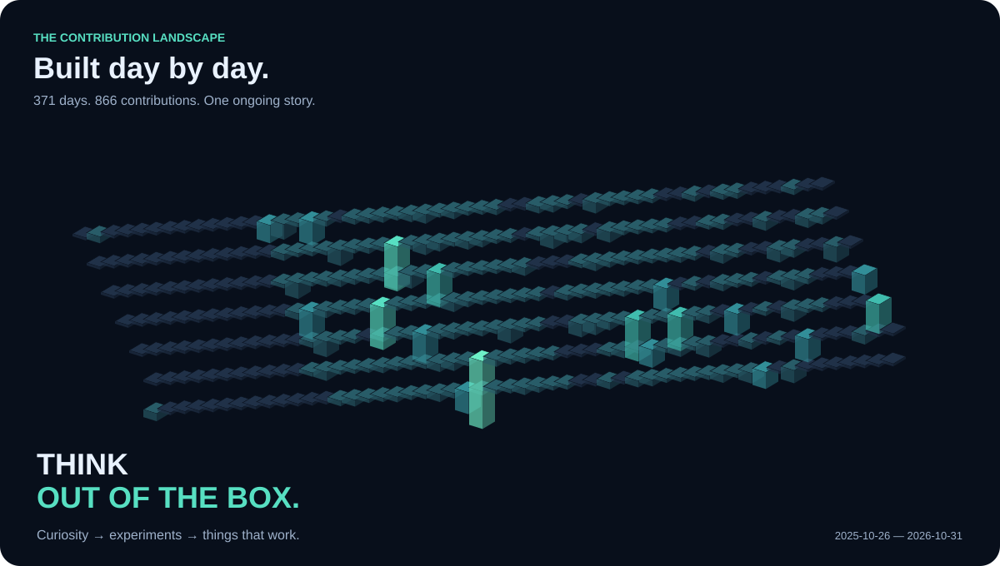

<div align="center">

```text
 █████╗ ███╗   ██╗██╗   ██╗██████╗   ██████╗  ██████╗ ██████╗      ██████╗  █████╗ ███████╗ █████╗ ██████╗ ██╗
██╔══██╗████╗  ██║██║   ██║██╔══██╗ ██╔═══██╗██╔═══██╗██╔══██╗     ██╔══██╗██╔══██╗██╔════╝██╔══██╗██╔══██╗██║
███████║██╔██╗ ██║██║   ██║██████╔╝ ██║   ██║██║   ██║██████╔╝     ██║  ██║███████║███████╗███████║██████╔╝██║
██╔══██╗██║╚██╗██║██║   ██║██╔══██╗ ██║   ██║██║   ██║██╔═══╝      ██║  ██║██╔══██║╚════██║██╔══██║██╔══██╗██║
██║  ██║██║ ╚████║╚██████╔╝██║  ██║ ╚██████╔╝╚██████╔╝██║          ██████╔╝██║  ██║███████║██║  ██║██║  ██║██║
╚═╝  ╚═╝╚═╝  ╚═══╝ ╚═════╝ ╚═╝  ╚═╝  ╚═════╝  ╚═════╝ ╚═╝          ╚═════╝ ╚═╝  ╚═╝╚══════╝╚═╝  ╚═╝╚═╝  ╚═╝╚═╝

                                                                                        Stay Humble. The tables always turned.
```


<p align="center">
  <b>B.Tech CSE (Data Science) Student</b> &nbsp;•&nbsp; <b>AI & ML Developer</b>
</p>


</div>

```text
┌──[ ANUROOP@GITHUB ]
│
├─ Role      → CSE (Data Science) Student
├─ Focus     → AI • LLM • RAG • Multi-Agent Systems
├─ Building  → Intelligent AI Applications
├─ Learning  → Advanced AI Engineering
├─ Code      → Python • Java • JavaScript • TypeScript
├─ Backend   → FastAPI • Django • Node.js
├─ Frontend  → React • Next.js • Tailwind CSS
├─ Database  → PostgreSQL • MySQL • MongoDB • Qdrant
└─ Status    → ████████████████████  ONLINE
```


## 👨‍💻 About Me

Hello! I'm **Anuroop Dasari**, a B.Tech Computer Science & Engineering (Data Science) student passionate about building intelligent systems and bridging the gap between cutting-edge AI research and real-world applications.

* 🎓 **Education**: B.Tech CSE (Data Science) Student
* 🧠 **AI & ML Focus**: Deeply interested in Large Language Models (LLMs), Retrieval-Augmented Generation (RAG), and Multi-Agent AI systems
* 🌐 **Full-Stack Development**: Crafting responsive frontends and robust backends for modern web applications
* ⚙️ **Automation & Systems**: Designing autonomous workflows and agentic tools to solve practical problems
* 📊 **Data Science**: Exploring data analytics, feature engineering, and predictive machine learning models
* 🚀 **Approach**: Learning by doing — building end-to-end projects to gain deep technical intuition


## ⚡Building

```text
[▓▓▓▓▓▓▓▓▓▓▓▓▓▓▓▓▓▓░░] 90%  🧠 RAG-based AI Systems
[▓▓▓▓▓▓▓▓▓▓▓▓▓▓▓▓░░░░] 80%  🤖 Multi-Agent Autonomous Systems
[▓▓▓▓▓▓▓▓▓▓▓▓▓▓▓▓▓░░░] 85%  📚 LLM-Powered Applications
[▓▓▓▓▓▓▓▓▓▓▓▓▓▓▓▓▓▓░░] 90%  ⚙️ AI Automation Workflows
[▓▓▓▓▓▓▓▓▓▓▓▓▓▓▓▓░░░░] 80%  🌐 Full-Stack AI Applications
[▓▓▓▓▓▓▓▓▓▓▓▓▓▓▓▓▓░░░] 85%  📊 Data Science & ML Projects
```





## 🔥 Contribution Matrix & Streak

<div align="center">


<br/><br/>


</div>


## 🛰️ Developer Status & System Activity

```text
╭──────────────────────────────────────────────╮
│              SYSTEM STATUS                   │
├──────────────────────────────────────────────┤
│ AI Systems       : BUILDING                  │
│ RAG             : LEARNING + BUILDING        │
│ Agents          : EXPERIMENTING              │
│ Full Stack      : DEVELOPING                 │
│ Open Source     : CONTRIBUTING               │
│ Coffee          : REQUIRED ☕                │
╰──────────────────────────────────────────────╯
```

<div align="center">


</div>


## 💬 Connect With Me

<div align="center">

<a href="https://github.com/ANU5565" target="_blank">
  
</a>
&nbsp;&nbsp;
<a href="https://www.linkedin.com/in/anuroop-dasari-20b8a4328" target="_blank">
  
</a> 
&nbsp;&nbsp;
<a href="https://leetcode.com/u/Anuruoop999" target="_blank">
  
</a>
&nbsp;&nbsp;
<a href="https://x.com/anu999" target="_blank">
  
</a>
&nbsp;&nbsp;
<a href="mailto:anurup911@gmail.com">
  
</a>
&nbsp;&nbsp;
<a href="https://www.icloud.com/mail/" target="_blank">
  
</a>
&nbsp;&nbsp;
<a href="https://www.instagram.com/anuu.rup" target="_blank">
  
</a>

</div>

---

<div align="center">

> *Build it. Break it. Understand it. Build it better.*

```text
────────────────────────────────────────────

      BUILDING • LEARNING • EXPERIMENTING

              ANUROOP DASARI

────────────────────────────────────────────
```

⭐ **If you find something interesting, feel free to explore my repositories!**

</div>
